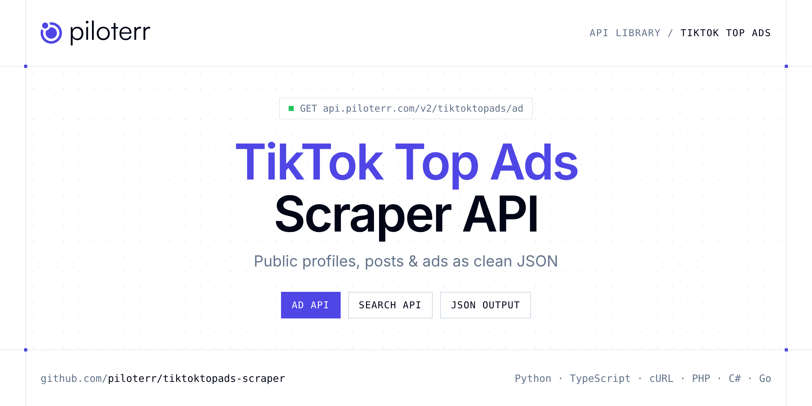

<p align="center">
  <a href="https://www.piloterr.com"></a>
</p>

# TikTok Top Ads Scraper API

[](https://discord.gg/CFj3ph8aHU) [](https://app.piloterr.com) [](https://app.piloterr.com/openapi) [](LICENSE)

The **Piloterr TikTok Top Ads Scraper API** lets you extract public data from TikTok Top Ads as **clean, structured JSON** — no proxies, headless browsers or HTML parsing to maintain. Endpoints available in production:

- **TikTok Top Ads Ad API** — Get one TikTok Creative Center Top Ad by URL or id: creative, landing page, CTR, and engagement (1 credit).
- **TikTok Top Ads Search API** — Search TikTok Creative Center Top Ads by region, objective, period, and keyword.

Use it for brand monitoring, social listening, influencer research, ad intelligence or content analytics on public data.

| Endpoint | Path | Credits | What you get |
|---|---|---|---|
| [TikTok Top Ads Ad API](#tiktok-top-ads-ad-api) | `/v2/tiktoktopads/ad` | 1 | Get one TikTok Creative Center Top Ad by URL or id |
| [TikTok Top Ads Search API](#tiktok-top-ads-search-api) | `/v2/tiktoktopads/search` | 1 | Search TikTok Creative Center Top Ads by region, objective, period, and keyword. Returns ad cards and pagination (1 credit). |

## Table of contents

- [How it works](#how-it-works)
- [TikTok Top Ads Ad API](#tiktok-top-ads-ad-api)
- [TikTok Top Ads Search API](#tiktok-top-ads-search-api)
- [Code examples in other languages](#code-examples-in-other-languages)
- [Practical use cases](#practical-use-cases)
- [Why Piloterr?](#why-piloterr)
- [FAQ](#faq)
- [Related scrapers](#related-scrapers)
- [Support](#support)

## How it works

1. **Create a free Piloterr account** and copy your API key from the [dashboard](https://app.piloterr.com).
2. **Send a `GET` (or `POST`) request** to `https://api.piloterr.com/v2/...` with the header `x-api-key: YOUR_API_KEY`.
3. **Receive structured JSON** — Piloterr handles rendering, proxies, retries and parsing.

```bash
export PILOTERR_API_KEY="your-api-key"
pip install requests        # Python
# TypeScript: Node.js 18+ (native fetch), run with `npx tsx file.ts`
```

> Every endpoint accepts both `GET` (query string) and `POST` (JSON body with the same fields).

## TikTok Top Ads Ad API

Get one TikTok Creative Center Top Ad by URL or id: creative, landing page, CTR, and engagement (1 credit).

`GET | POST https://api.piloterr.com/v2/tiktoktopads/ad` · **1 credit per request** · [Full reference](https://app.piloterr.com/openapi)

### Request parameters

| Parameter | Type | Required | Description |
|---|---|---|---|
| `query` | string | ✅ | Ad id or detail URL from search. |

### Python example

```python
import json
import os
import requests

response = requests.get(
    "https://api.piloterr.com/v2/tiktoktopads/ad",
    headers={"x-api-key": os.environ["PILOTERR_API_KEY"]},
    params={
        "query": "https://ads.tiktok.com/business/creativecenter/topads/7686267188656750612/pc/en?period=30",
    },
    timeout=60,
)
response.raise_for_status()
data = response.json()

print(json.dumps(data, indent=2, ensure_ascii=False)[:2000])
```

### TypeScript example

```typescript
type TiktokTopAdsAd = {
  ctr?: number;
  url?: string;
  cost?: number;
  ad_id?: string;
  format?: string;
  source?: string;
  duration?: number;
  headline?: string;
  countries?: string[];
  image_url?: string;
  objective?: string;
  video_url?: string;
  like_count?: number;
  objectives?: {
    label?: string;
    value?: number;
  }[];
  voice_over?: unknown;
  share_count?: number;
  industry_key?: string;
  keyword_list?: unknown;
  landing_page?: string;
  comment_count?: number;
  advertiser_name?: string;
};

const params = new URLSearchParams({
  "query": "https://ads.tiktok.com/business/creativecenter/topads/7686267188656750612/pc/en?period=30",
});

const response = await fetch(`https://api.piloterr.com/v2/tiktoktopads/ad?${params}`, {
  headers: { "x-api-key": process.env.PILOTERR_API_KEY! },
});
if (!response.ok) throw new Error(`Piloterr error ${response.status}: ${await response.text()}`);

const data = (await response.json()) as TiktokTopAdsAd;

console.log(JSON.stringify(data, null, 2).slice(0, 2000));
```

<details>
<summary><b>POST variant</b></summary>

```http
POST https://api.piloterr.com/v2/tiktoktopads/ad
x-api-key: YOUR_API_KEY
Content-Type: application/json

{"query": "https://ads.tiktok.com/business/creativecenter/topads/7686267188656750612/pc/en?period=30"}
```
</details>

### Output example

Example response from the API reference, abridged — real values depend on the page you scrape.

```json
{
  "ctr": 0.22,
  "url": "https://ads.tiktok.com/business/creativecenter/topads/7686267188656750612/pc/en?period=30",
  "cost": 1,
  "ad_id": "7686267188656750612",
  "format": "video",
  "source": "TikTok Ads Manager",
  "duration": 32.9,
  "headline": "25% Off Our Popular Juice Groove Router Jig. Limited Time Sale!",
  "countries": [
    "US"
  ],
  "image_url": "https://p16.tiktokcdn.com/detail-cover.jpg",
  "objective": "campaign_objective_conversion",
  "video_url": "https://v16.tiktokcdn.com/detail.mp4",
  "like_count": 39,
  "objectives": [
    {
      "label": "campaign_objective_conversion",
      "value": 3
    }
  ],
  "voice_over": null,
  "share_count": 1,
  "industry_key": "label_21103000000",
  "keyword_list": null,
  "landing_page": "https://craftedelements.com/products/juice-groove-router-jig",
  "comment_count": 0,
  "advertiser_name": "crafted elements"
}
```

### Response fields

| Field | Type | Description |
|---|---|---|
| `ctr` | number |  |
| `url` | string |  |
| `cost` | integer |  |
| `ad_id` | string |  |
| `format` | string |  |
| `source` | string |  |
| `duration` | number |  |
| `headline` | string |  |
| `countries` | string[] |  |
| `image_url` | string |  |
| `objective` | string |  |
| `video_url` | string |  |
| `like_count` | integer |  |
| `objectives[]` | object[] |  |
| `objectives[].label` | string |  |
| `objectives[].value` | integer |  |
| `voice_over` | object |  |
| `share_count` | integer |  |
| `industry_key` | string |  |
| `keyword_list` | object |  |
| `landing_page` | string |  |
| `comment_count` | integer |  |
| `advertiser_name` | string |  |

## TikTok Top Ads Search API

Search TikTok Creative Center Top Ads by region, objective, period, and keyword. Returns ad cards and pagination (1 credit).

`GET | POST https://api.piloterr.com/v2/tiktoktopads/search` · **1 credit per request** · [Full reference](https://app.piloterr.com/openapi)

### Request parameters

| Parameter | Type | Required | Description |
|---|---|---|---|
| `query` | string | — | Full TikTok Top Ads search URL, or a keyword. |
| `keyword` | string | — | Brand or product keyword. |
| `region` | string | — | ISO country code (`country_code`). |
| `objective` | string | — | Campaign objective id (URL param `object`). |
| `period` | string | — | Lookback window: `7`, `30`, or `180`. |
| `order_by` | string | — | Sort: `for_you`, `reach`/`impression`, `ctr`/`like`. |
| `industry` | string | — | Industry key filter. |
| `page` | number | — | Page number. |
| `per_page` | number | — | Page size (max 20). |

### Python example

```python
import json
import os
import requests

response = requests.get(
    "https://api.piloterr.com/v2/tiktoktopads/search",
    headers={"x-api-key": os.environ["PILOTERR_API_KEY"]},
    params={
        "query": "https://ads.tiktok.com/business/creativecenter/inspiration/topads/pc/en?period=30&region=AR",
    },
    timeout=60,
)
response.raise_for_status()
data = response.json()

print(json.dumps(data, indent=2, ensure_ascii=False)[:2000])
```

### TypeScript example

```typescript
type TiktokTopAdsSearch = {
  results?: {
    ctr?: number;
    url?: string;
    cost?: number;
    ad_id?: string;
    format?: string;
    headline?: string;
    image_url?: string;
    objective?: string;
    video_url?: string;
    like_count?: number;
    industry_key?: string;
    advertiser_name?: string;
  }[];
  pagination?: {
    next?: string;
    page?: number;
    cursor?: string;
    per_page?: number;
    total_pages?: number;
    total_results?: number;
  };
};

const params = new URLSearchParams({
  "query": "https://ads.tiktok.com/business/creativecenter/inspiration/topads/pc/en?period=30&region=AR",
});

const response = await fetch(`https://api.piloterr.com/v2/tiktoktopads/search?${params}`, {
  headers: { "x-api-key": process.env.PILOTERR_API_KEY! },
});
if (!response.ok) throw new Error(`Piloterr error ${response.status}: ${await response.text()}`);

const data = (await response.json()) as TiktokTopAdsSearch;

console.log(JSON.stringify(data, null, 2).slice(0, 2000));
```

<details>
<summary><b>POST variant</b></summary>

```http
POST https://api.piloterr.com/v2/tiktoktopads/search
x-api-key: YOUR_API_KEY
Content-Type: application/json

{"query": "https://ads.tiktok.com/business/creativecenter/inspiration/topads/pc/en?period=30&region=AR"}
```
</details>

### Output example

Example response from the API reference, abridged — real values depend on the page you scrape.

```json
{
  "results": [
    {
      "ctr": 0.97,
      "url": "https://ads.tiktok.com/business/creativecenter/topads/7683821191329005569/pc/en?period=30",
      "cost": 0,
      "ad_id": "7683821191329005569",
      "format": "video",
      "headline": "DESCUBRE",
      "image_url": "https://p16.tiktokcdn.com/cover.jpg",
      "objective": "campaign_objective_lead_generation",
      "video_url": "https://v16.tiktokcdn.com/video.mp4",
      "like_count": 4120,
      "industry_key": "label_10104000000",
      "advertiser_name": "Example Brand"
    }
  ],
  "pagination": {
    "next": "https://ads.tiktok.com/business/creativecenter/inspiration/topads/pc/en?period=30&region=AR&page=2",
    "page": 1,
    "cursor": "2",
    "per_page": 20,
    "total_pages": 3,
    "total_results": 47
  }
}
```

### Response fields

| Field | Type | Description |
|---|---|---|
| `results[]` | object[] |  |
| `results[].ctr` | number |  |
| `results[].url` | string |  |
| `results[].cost` | integer |  |
| `results[].ad_id` | string |  |
| `results[].format` | string |  |
| `results[].headline` | string |  |
| `results[].image_url` | string |  |
| `results[].objective` | string |  |
| `results[].video_url` | string |  |
| `results[].like_count` | integer |  |
| `results[].industry_key` | string |  |
| `results[].advertiser_name` | string |  |
| `pagination` | object |  |
| `pagination.next` | string |  |
| `pagination.page` | integer |  |
| `pagination.cursor` | string |  |
| `pagination.per_page` | integer |  |
| `pagination.total_pages` | integer |  |
| `pagination.total_results` | integer |  |

## Code examples in other languages

Ready-to-run examples live in the [`examples/`](examples) folder. Each one reads your key from the `PILOTERR_API_KEY` environment variable.

| Language | Ad | Search |
|---|---|---|
| cURL (Bash) | [`ad`](examples/curl/ad.sh) | [`search`](examples/curl/search.sh) |
| PHP | [`ad`](examples/php/ad.php) | [`search`](examples/php/search.php) |
| C# | [`ad`](examples/csharp/Ad.cs) | [`search`](examples/csharp/Search.cs) |
| Go | [`ad`](examples/go/ad.go) | [`search`](examples/go/search.go) |
| Java | [`ad`](examples/java/AdExample.java) | [`search`](examples/java/SearchExample.java) |
| Ruby | [`ad`](examples/ruby/ad.rb) | [`search`](examples/ruby/search.rb) |
| Node.js | [`ad`](examples/nodejs/ad.mjs) | [`search`](examples/nodejs/search.mjs) |

## Practical use cases

- **Brand monitoring** — Follow public mentions and engagement around your brand.
- **Social listening** — Analyse public conversations and trends.
- **Influencer research** — Qualify public creator profiles and audience metrics.
- **Ad intelligence** — Study competitors' public ads and creatives.
- **Content analytics** — Benchmark formats and engagement over time.

## Why Piloterr?

- **No infrastructure** — no proxies, headless browsers or CAPTCHA solving to run yourself.
- **Structured JSON** — stable, documented fields instead of brittle HTML selectors.
- **Pay per request** — transparent credit cost per endpoint, failed requests are retried for you.
- **One API key, hundreds of sources** — TikTok Top Ads plus many other e-commerce, search and company data endpoints in the [Piloterr library](https://www.piloterr.com/library).
- **Any language** — plain HTTPS + JSON, with examples for Python, TypeScript, cURL, PHP, C#, Go, Java, Ruby and Node.js.

## FAQ

### Is it legal to scrape TikTok Top Ads?

Collecting publicly available data is generally allowed in many jurisdictions, but rules depend on your country, the data you collect and how you use it. Avoid personal data unless you have a lawful basis, respect the website's terms where they apply, and get legal advice for your specific use case. This is not legal advice.

### Do I need proxies or a headless browser?

No. Piloterr handles rendering, proxy rotation and retries on its side. You only send an HTTPS request with your `x-api-key` header and receive JSON.

### How much does a request cost?

Credits per call: `/v2/tiktoktopads/ad` **1**, `/v2/tiktoktopads/search` **1**. See the [Piloterr website](https://www.piloterr.com) for plans.

### What data does the TikTok Top Ads API return?

Each endpoint returns structured JSON: **TikTok Top Ads Ad** — `ctr`, `url`, `cost`, `ad_id`, `format`, `source`; **TikTok Top Ads Search** — `results[]`, `results[].ctr`, `results[].url`, `results[].cost`, `results[].ad_id`, `results[].format`.

### How do I paginate TikTok Top Ads results?

Use the `page` parameter and keep requesting while the response indicates more results.

### Can I target a specific country or language?

Yes, use `region` — see the parameter tables above for accepted values.

### Which languages are supported?

Any language that can make an HTTP request. This README shows Python and TypeScript; the [`examples/`](examples) folder contains cURL, PHP, C#, Go, Java, Ruby and Node.js.

## Related scrapers

- [Instagram Scraper API](https://github.com/piloterr/instagram-scraper)
- [Kick Scraper API](https://github.com/piloterr/kick-scraper)
- [Patreon Scraper API](https://github.com/piloterr/patreon-scraper)
- [Pinterest Scraper API](https://github.com/piloterr/pinterest-scraper)
- [weibo-scraper](https://github.com/piloterr/weibo-scraper)
- [X (Twitter) Scraper API](https://github.com/piloterr/twitter-x-scraper)
- [All Piloterr scrapers on GitHub](https://github.com/piloterr)

## Support

- 💬 Join the [Piloterr Discord](https://discord.gg/CFj3ph8aHU) to ask questions and share what you build.
- 📚 Browse the [API reference (OpenAPI)](https://app.piloterr.com/openapi) and the [Piloterr library](https://www.piloterr.com/library).
- 🔑 [Get your API key](https://app.piloterr.com).

---

<p align="center">
  <a href="https://www.piloterr.com">
    <picture>
      <source media="(prefers-color-scheme: dark)" srcset="images/logo-dark.svg">
      
    </picture>
  </a>
  <br>
  <sub>Built by <a href="https://www.piloterr.com">Piloterr</a> — web scraping APIs for e-commerce, search, real estate and more, one API key.</sub>
</p>

<sub>TikTok Top Ads is a trademark of its respective owner. This repository is not affiliated with or endorsed by TikTok Top Ads. Examples are released under the MIT license.</sub>
